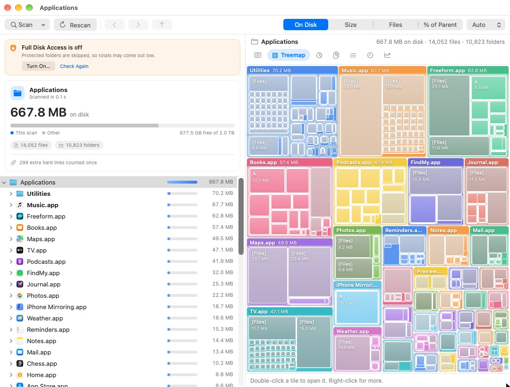
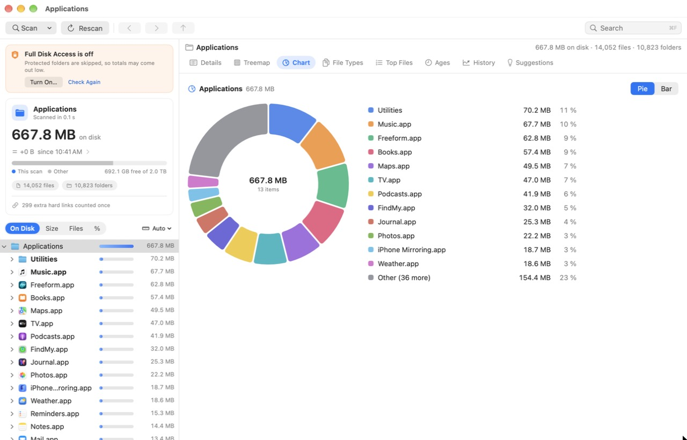

# DiskLens

**See what's using your disk.** DiskLens is a free, open-source disk space analyzer for macOS, in the spirit
of TreeSize and WinDirStat: a folder tree with size bars, a treemap, charts, file types, your largest files,
and how old your data is.



- **Free and open source** under the MIT license. No account, no ads, no telemetry.
- **Private**: DiskLens never connects to the internet. Everything stays on your Mac.
- **Fast and native**: built with SwiftUI and AppKit, it scans about half a million files in a few seconds.
- **Easy to build**: one command with Apple's free Command Line Tools. No Xcode, no Apple developer account,
  no Gatekeeper warnings.

Requires macOS 14 (Sonoma) or later, on Apple silicon or Intel.

## Install

1. Install Apple's free Command Line Tools, if you haven't already:

   ```bash
   xcode-select --install
   ```

2. Download DiskLens, build it and put it in Applications:

   ```bash
   git clone https://github.com/akashsingh73/DiskLens.git
   cd DiskLens
   bash build.sh --install --open
   ```

That builds `DiskLens.app`, copies it to `/Applications` and opens it. Without `--install` the app stays in `build/`.
To update later, run `git pull` and then `bash build.sh --install --open` again.

Prefer Xcode? Open `DiskLens.xcodeproj` and press ⌘R. It's set to "Sign to Run Locally" with App Sandbox off,
so no team or account is needed.

### Give it Full Disk Access

macOS hides Mail, Messages, Safari and other protected folders from every app until you allow it, so without
this, totals come out low. Open System Settings ▸ Privacy & Security ▸ Full Disk Access, add DiskLens, then quit
and reopen it. DiskLens shows a notice while access is off, and lists any folders it couldn't read.

### Optional: keep Full Disk Access when you rebuild

macOS remembers Full Disk Access by the app's signature. By default `build.sh` uses an ad-hoc signature, which
is different for every build, so after rebuilding you have to remove DiskLens from the Full Disk Access list
(minus button) and add it again (plus button).

To avoid that, create a free code-signing certificate once. It stays on your Mac and needs no Apple account:

1. Open Keychain Access (search for it with Spotlight), then choose Keychain Access ▸ Certificate Assistant ▸ Create a Certificate…
2. Name: `DiskLens Local`. Identity Type: Self Signed Root. Certificate Type: Code Signing. Click Create, then Done.
3. Run `bash build.sh --install --open`. The first time, macOS asks whether `codesign` may use the key: enter your password and click Always Allow.
4. Give DiskLens Full Disk Access one last time.

From then on `build.sh` signs every build with that certificate (it says which signature it used), and access
carries over. To use a certificate with another name, set `DISKLENS_SIGN_IDENTITY`. Builds from Xcode keep the
ad-hoc signature, so use `build.sh` for the copy you keep in Applications.

## Features

- **Summary card**: the scan's total, how much of the disk it takes, and file and folder counts.
- **Folder tree** with a size bar on every row (scaled to the whole scan, or to the parent folder), bold for big
  folders, a `[Files]` entry for each folder's loose files, and an option to hide small items.
- **Size modes**: On Disk (space really used), Size, file count, or % of parent; units auto, B, KB, MB, GB, TB;
  decimal (like Finder) or binary units.
- **Details**: a sortable list with columns you can hide (right-click the header): On Disk, % of Parent, Size,
  Files, Folders, Modified, Kind.
- **Treemap**: each top-level folder has its own colour and a labelled title strip; deeper folders get lighter
  shades. Adjustable level of detail.
- **Chart**: a donut (or bars) of a folder's subfolders, with the total in the middle.
- **File Types** by group and extension, **Top Files** (the 100 largest by default, each with the app or folder it
  lives in), **Ages** (by modification date, including how much hasn't changed in a year) and **History** (a point
  per scan, so you can watch a folder grow).
- **Search** (⌘F): find folders and files by name anywhere in the scan, largest first, with where each one is.
  Folders and Top Files show up as you type; other files turn up as DiskLens reads the scanned folders again in the
  background (a scan keeps only folder totals, not every file). Choose a result to go there.
- **Recent scans** on the start screen, to scan a folder again with one click.
- **Clean up safely**: right-click anything to reveal it in Finder, open it, Quick Look it, copy its path, or move
  it to the Trash. DiskLens always asks first, never deletes outright, and refuses system folders and your home
  folder. Every view updates without a rescan.



## Getting around

| To | Do this |
| --- | --- |
| Scan | ⌘O to choose a folder (or drop one onto the window), ⇧⌘H for your home folder, ⌘R to rescan, ⌘. to stop |
| Open a folder | Double-click it (or select it and press Return) in Details or the Treemap, or click it in the tree or the chart legend |
| Go back up | Click any folder in the path bar above the views, or press ⌘↑ |
| Back / Forward | The arrow buttons at the top left, ⌘[ and ⌘], or the side buttons on your mouse |
| Jump to the top of the scan | ⇧⌘↑ |
| Find a folder or file by name | ⌘F (or click Search at the top right), type part of the name, then ↑↓ and Return to go there |
| Switch views | ⌘1 Details, ⌘2 Treemap, ⌘3 Chart, ⌘4 File Types, ⌘5 Top Files, ⌘6 Ages, ⌘7 History |
| Preview a file | Select it in Details and press Space |
| Change units, bar colours, treemap detail | DiskLens ▸ Settings (⌘,) |

## How sizes are counted

- **On Disk** uses the blocks a file really occupies, so iCloud files that aren't downloaded, sparse files (such as
  Docker's disk image) and compressed files count honestly. It matches `du`.
- Hard-linked files are counted once. In Details, the other links show 0 on disk and the kind
  "Hard link (counted elsewhere)", so a folder's rows always add up to its total.
- A scan never leaves the disk it started on and never follows symbolic links.
- Scanning the startup disk scans its data volume (`/System/Volumes/Data`), which holds everything you can change.
  The read-only macOS system volume is not included.
- Totals can still differ from System Settings, which also counts local Time Machine snapshots and purgeable
  space, and from files shared between APFS clones.

## Privacy

- DiskLens makes no network connections.
- It reads file names, sizes, dates and icons. It opens a file only when you ask it to (Open or Quick Look).
- It keeps a small scan history (one total per scan) in `~/Library/Application Support/DiskLens/history.json`,
  and its settings in the macOS defaults domain `local.disklens.app`. Nothing else is stored.

## Uninstall

Quit DiskLens and delete `/Applications/DiskLens.app`. To remove its history and settings too:

```bash
rm -rf ~/Library/Application\ Support/DiskLens
```

```bash
defaults delete local.disklens.app
```

You can also remove it from System Settings ▸ Privacy & Security ▸ Full Disk Access.

## Troubleshooting

- **"The Swift compiler isn't installed yet"**: run `xcode-select --install`, then build again.
- **The build stopped**: the full list of errors is in `build/compile.log`.
- **Totals look low**: turn on Full Disk Access (see above). The summary lists the folders DiskLens couldn't read.
- **Diagnostics**: DiskLens writes to the system log. Open Console, click Start streaming, and search for
  `local.disklens.app`. Crash reports are in Console ▸ Crash Reports.

## Contributing

Issues and pull requests are welcome. Before sending a change, run the tests:

```bash
bash test.sh
```

It first checks that the code compiles cleanly in the Swift 6 language mode, then builds a small folder tree in a
temporary folder (hard links, symbolic links, a sparse file, unreadable folders, an old file), scans it, and checks
the results, including against `du`. To compare real folders with `du` too, name them: `bash test.sh /Applications`.
It needs only the Command Line Tools.

A few rules keep DiskLens stable; please keep to them:

- **No SwiftUI toolbar.** An early version crashed with "too many Update Constraints in Window passes", a layout
  loop between SwiftUI's toolbar and the window. The controls sit in an ordinary bar inside the window, the folder
  tree applies its changes just after SwiftUI's update instead of during it, and no view measures itself and
  writes the size back into its own state.
- **No SwiftUI macros** (`@State`, `@Observable`): the Command Line Tools don't include the plugin they need.
  View state lives in small `ObservableObject` classes instead.
- **Threads**: the scan runs on background threads; everything on screen is updated on the main thread only.
- **Big folders stay responsive**: Details lists at most the 50,000 largest files of a folder, "Expand All
  Below" stops after a few thousand folders, and search keeps only the 500 largest matches and reads folders on
  background threads, stopping as soon as the text changes.

### Project layout

| File | What it does |
| --- | --- |
| `build.sh`, `test.sh` | Build (and install) the app; run the tests |
| `Tests/DiskLensTests.swift` | The tests |
| `DiskLens/ScanEngine.swift`, `Scanner.swift` | The scanner: reads the top two levels, then scans branches in parallel with `fts` |
| `DiskLens/Node.swift`, `ScanTypes.swift` | The folder tree and scan statistics |
| `DiskLens/TreeOutline.swift` | The folder tree with size bars (AppKit outline view) |
| `DiskLens/Navigation.swift` | The command bar (scan, back, forward, up, size mode, search) and the clickable path bar |
| `DiskLens/Search.swift`, `SearchView.swift` | Search (⌘F): matching and ranking names, reading folders again for files; the search field and panel |
| `DiskLens/DetailsView.swift`, `TreemapView.swift`, `ChartsView.swift`, `AnalysisViews.swift` | The views on the right |
| `DiskLens/Settings.swift`, `SettingsView.swift` | Preferences and the Settings window |
| `DiskLens/ContentView.swift`, `AppModel.swift`, `DiskLensApp.swift` | Window layout, tabs, summary card, start and scanning screens, navigation history, scan control, menus |
| `DiskLens/Theme.swift` | The look: colour palette, cards, chips, icons for file types |
| `DiskLens/Support.swift` | Logging, file type groups, Finder actions, Full Disk Access check, scan history |
| `DiskLens/AppIcon.icns`, `Tools/make-icon.swift` | The app icon, and the script that draws it (`swift Tools/make-icon.swift`) |
| `DiskLens/Info.plist` | The icon setting Xcode merges into its generated Info.plist (`build.sh` writes its own) |

## License

DiskLens is released under the [MIT License](LICENSE).
